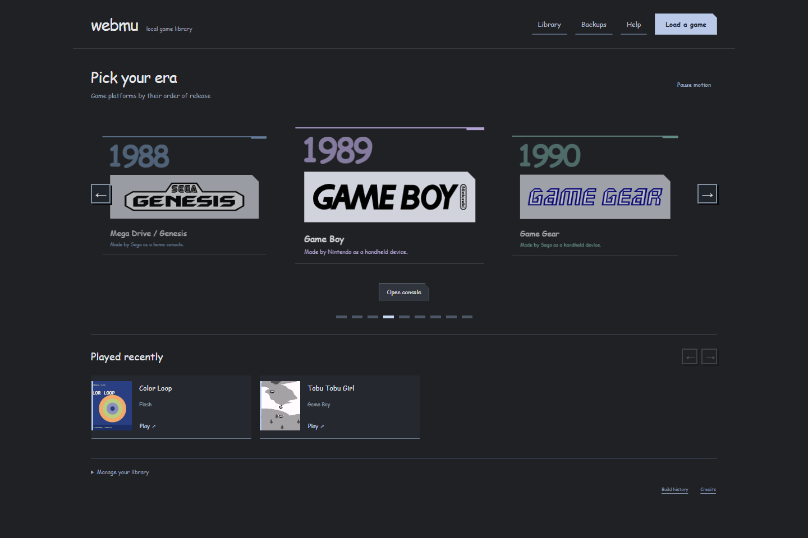

# Webmu

A little collection of consoles because apparently one wasn't enough.

## Description


Import your game file, choose your console, and then play in your browser. There is a small game library provided for you to test play, but I don't find any of the games to be particularly fun lol.

Made with HTML, CSS and JavaScript. EmulatorJS and Ruffle do the actual emulation. I did not casually write nine emulators for a random project.

### Screenshots



## Getting Started

### Dependencies

* Node.js and npm
* A modern browser. Works for me on chrome and edge on windows.
* Emulator files included.

### Installing

Clone repo or download the zip.

```sh
git clone https://github.com/BonC-Dev/Webmu.git
cd Webmu
npm install
```

### Executing program

```sh
npm start
```

Open the url it gives you, and import your own game if you want the full experience. 

## Help

If your page doesn't open, check if your terminal process is still running or not.

Your library is in browser storage, so switching browsers doesn't keep your saves.


## License

Original app code uses the [MIT License](LICENSE.md).

Emulators and sample games have their own licenses, listed in [THIRD_PARTY_NOTICES.md](THIRD_PARTY_NOTICES.md) and assets/examples.
